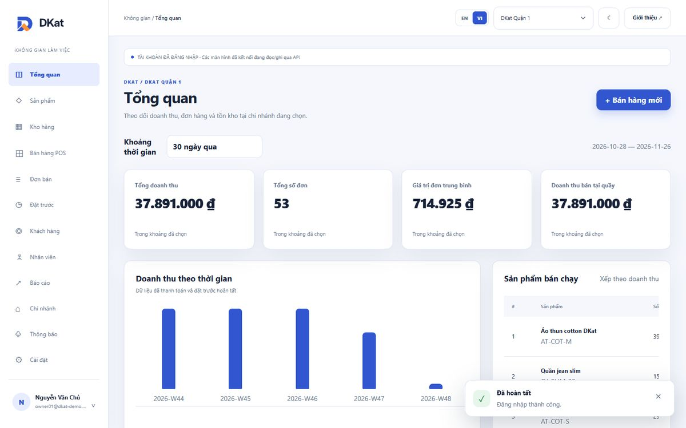
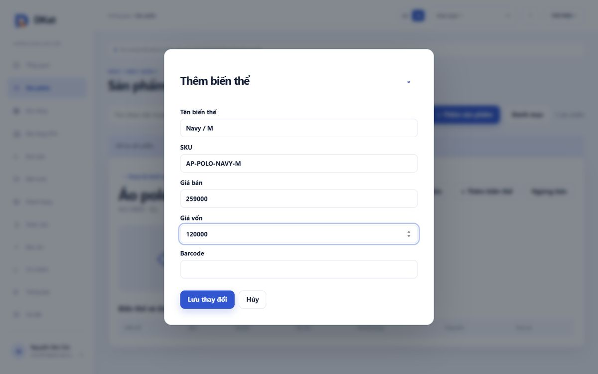
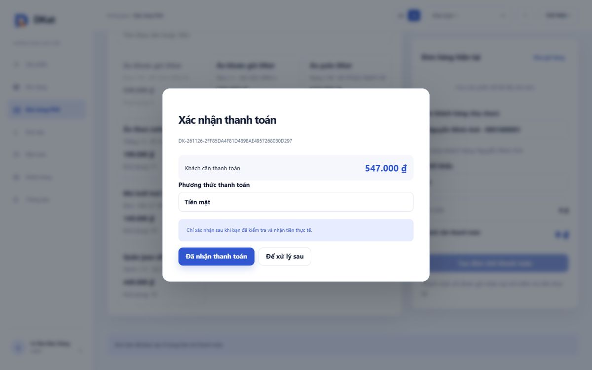
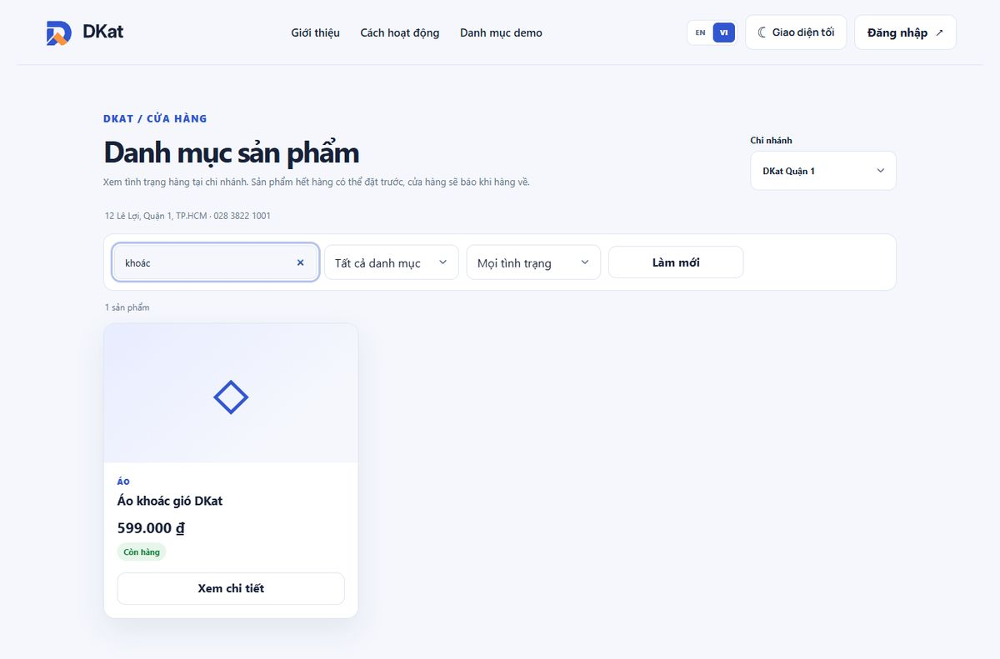
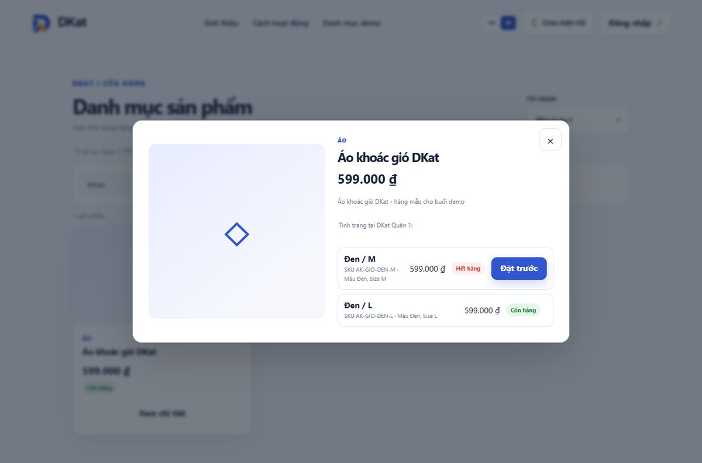
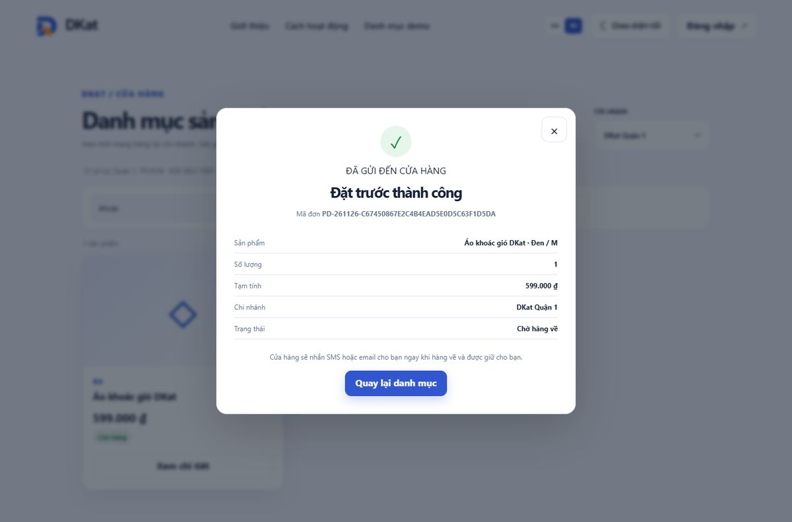
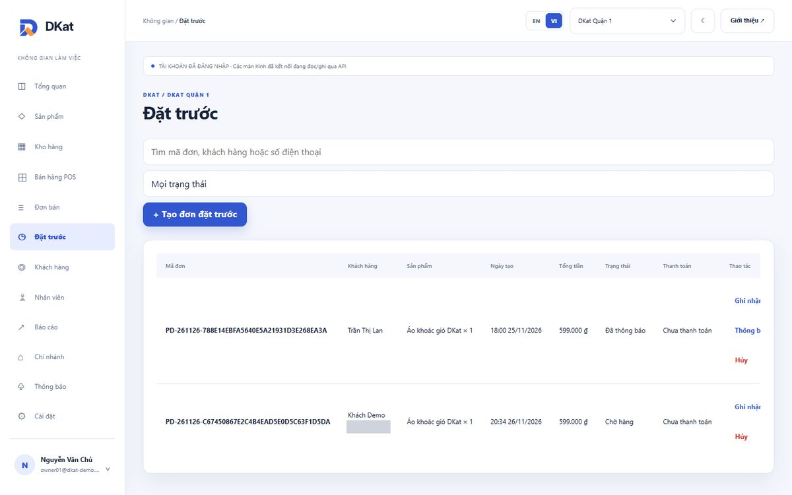
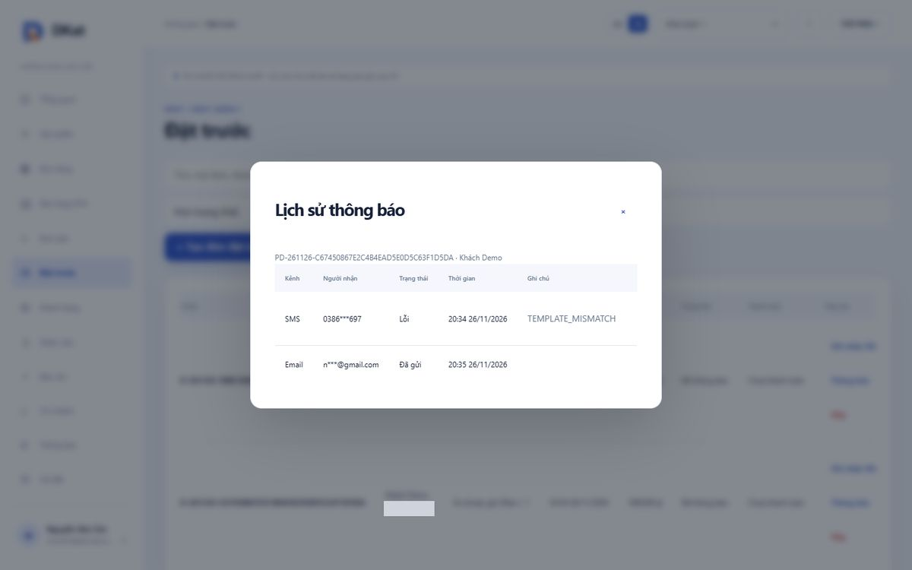
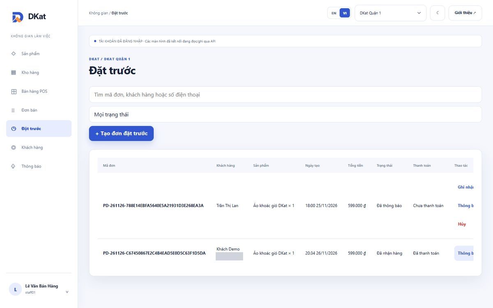
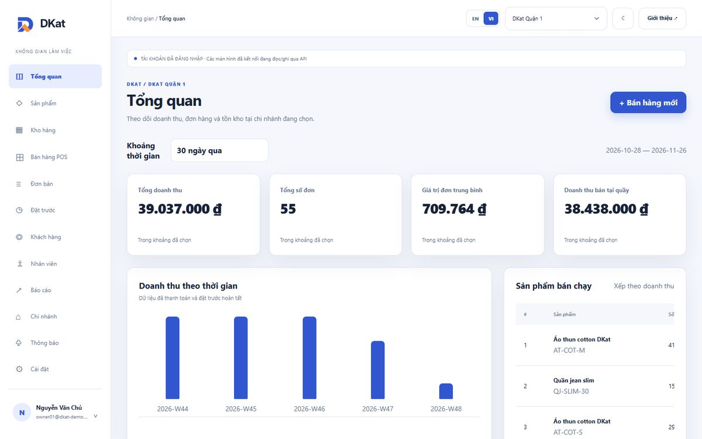

# Kịch bản demo cuối kỳ DKat (10-12 phút)

Câu chuyện: chuỗi **DKat Fashion** có 3 chi nhánh. Một khách hỏi chiếc áo khoác đang hết hàng. Thay vì ghi số điện thoại vào sổ rồi quên gọi lại, khách tự đặt trước trên website. Khi hàng về, hệ thống giữ hàng theo đúng thứ tự đặt và tự báo cho khách.

Thứ tự 9 bước: đăng nhập OWNER → tạo sản phẩm → bán hàng POS → khách đặt trước trên website → nhập kho → FIFO → SMS/email → xác nhận nhận hàng → dashboard.

**Đã chạy thử trọn kịch bản ngày 25/11/2026 và chạy lại ngày 26/11/2026 sau khi đổi trang website (tìm kiếm, lọc, trang chi tiết), không phải sửa dữ liệu bằng tay:**
- Bằng API: `scripts/demo_dry_run.py`, đạt 10/10 bước.
- Bằng giao diện thật trên Edge: đạt 8/8 thao tác chính. Ảnh trong tài liệu này lấy từ lần chạy đó.

---

## 1. Tài khoản và dữ liệu demo

Mật khẩu chung: **`DKat@Demo2026`**. Đặt mật khẩu khác bằng `DEMO_PASSWORD` trong `backend/.env`.

| Dùng ở bước | Tài khoản / dữ liệu | Ô "Tên đăng nhập" gõ | Ghi chú |
|---|---|---|---|
| 1, 2, 5, 6, 9 | OWNER Nguyễn Văn Chủ | `owner01` | Cửa sổ trình duyệt thường |
| 3, 8 | Nhân viên Lê Văn Bán Hàng, chi nhánh CN01 | `staff01:staff` | **Phải có `:staff`**, mở bằng cửa sổ InPrivate/Ẩn danh |
| (dự phòng) | Quản lý Trần Thị Quản Lý, CN01 + CN02 | `manager01:manager` | |
| 3 | Khách quen **Nguyễn Minh Anh** | tìm bằng `0901000001` | Số giả, chỉ có trong dữ liệu demo |
| 6 | Khách xếp hàng số 1 **Trần Thị Lan** | (có sẵn) | Đặt từ 18:00 hôm qua. Chỉ có email, là hộp thư nhóm (`DEMO_QUEUE_EMAIL`, mặc định `SMTP_FROM_EMAIL`) |
| 4, 7 | **Khách Demo** (người dẫn) | SĐT và email thật của người dẫn | Nhận SMS/email thật. Ghi trong `backend/.env`: `SMS_TEST_TO`, `EMAIL_TEST_TO` (hoặc `DEMO_CUSTOMER_PHONE`, `DEMO_CUSTOMER_EMAIL`) |

Không ghi SĐT/email thật vào repo: các giá trị này chỉ nằm trong `backend/.env` trên máy chạy demo.

Dữ liệu có sẵn sau `demo_reset`:

| Chi nhánh | Sản phẩm (giá) | Tồn CN01 |
|---|---|---|
| CN01 DKat Quận 1 (hotline 028 3822 1001), CN02 DKat Cầu Giấy, CN03 DKat Hải Châu | Áo thun cotton DKat Trắng S/M/L (199.000 đ) | 11 mỗi size |
| | Quần jean slim Xanh 29/30/31 (449.000 đ) | khoảng 10 mỗi size |
| | Mũ lưỡi trai DKat Đen (149.000 đ) | 10 |
| | **Áo khoác gió DKat Đen / M (599.000 đ)** | **0 ở mọi chi nhánh.** Chị Lan đã đặt trước 1 chiếc |
| | Áo khoác gió DKat Đen / L (599.000 đ) | 6 |

Ngoài ra có 74 đơn đã thanh toán trong 29 ngày gần nhất để dashboard có số liệu. Mở đầu, dashboard CN01 (30 ngày qua) hiển thị **37.891.000 đ, 53 đơn**.

## 2. Chuẩn bị (trước giờ demo 30 phút)

1. Lấy code: `git checkout develop && git pull`.
2. `backend/.env` cần có:
   - `DB_*` với **`DB_NAME=dkat_demo`**. Script reset từ chối mọi tên database không bắt đầu bằng `dkat_demo`.
   - `DB_SSL_MODE=disabled` nếu dùng MySQL cài trên máy.
   - `DKAT_ADMIN_TOKEN` (từ 32 ký tự trở lên), `DKAT_AUTH_SECRET_KEY`.
   - `SMTP_*` (Gmail App Password), `ESMS_*`, `SMS_TEST_TO`, `EMAIL_TEST_TO`.
3. `frontend/.env.local`:
   ```
   VITE_API_BASE_URL=http://127.0.0.1:8000/api/v1
   VITE_PUBLIC_STORE_ID=1
   ```
4. Mở 2 terminal:
   ```powershell
   # Terminal 1 (backend/)
   .venv\Scripts\python.exe -m pip install -r requirements.txt   # lần đầu
   .venv\Scripts\python.exe -m scripts.demo_reset                # khoảng 20 giây, in ra danh sách tài khoản
   .venv\Scripts\python.exe -m uvicorn app.main:app --port 8000
   # Terminal 2 (frontend/)
   npm ci                                                         # lần đầu
   npm run dev                                                    # http://127.0.0.1:5173
   ```
5. Tối hôm trước nên diễn tập một lần: `python -m scripts.demo_dry_run`, rồi **chạy lại `demo_reset`**, vì lần chạy thử đã dùng hết dữ liệu.
6. Mở sẵn các cửa sổ, zoom trình duyệt 90%:
   - **Cửa sổ A (thường):** tab 1 `http://127.0.0.1:5173/#/login` (OWNER), tab 2 `http://127.0.0.1:5173/#/catalog` (website khách).
   - **Cửa sổ B (InPrivate):** `http://127.0.0.1:5173/#/login`, đăng nhập sẵn `staff01:staff`, mở trang **Bán hàng POS**.
   - **Điện thoại hoặc tab Gmail** của người dẫn: mở sẵn hộp thư đến.

   Không đăng nhập OWNER và nhân viên trong cùng một cửa sổ: hai tài khoản dùng chung cookie phiên.

## 3. Kịch bản

| Thời gian | Bước |
|---|---|
| 0:00-0:45 | Mở đầu |
| 0:45-1:30 | 1. Đăng nhập OWNER |
| 1:30-3:00 | 2. Tạo sản phẩm |
| 3:00-4:30 | 3. Bán hàng POS |
| 4:30-6:00 | 4. Khách đặt trước trên website |
| 6:00-7:00 | 5. Nhập kho |
| 7:00-7:45 | 6. FIFO |
| 7:45-9:15 | 7. SMS/email |
| 9:15-10:15 | 8. Xác nhận nhận hàng |
| 10:15-11:15 | 9. Dashboard |
| 11:15-12:00 | Kết |

### Mở đầu (0:00-0:45)
> "DKat quản lý bán hàng cho chuỗi cửa hàng nhiều chi nhánh: sản phẩm, kho, POS, và điểm khác biệt là **đặt trước hàng hết**. Khách đặt trên website, hàng về thì hệ thống giữ hàng theo thứ tự và tự nhắn khách."

### Bước 1. Đăng nhập OWNER (0:45-1:30) · Cửa sổ A, tab 1
1. Gõ `owner01` / `DKat@Demo2026`, bấm **Đăng nhập**.
2. Màn hình **Tổng quan** của CN01: 30 ngày qua có **37.891.000 đ, 53 đơn**, kèm biểu đồ theo tuần và sản phẩm bán chạy.

> "Chủ cửa hàng thấy ngay doanh thu chi nhánh. Ghi nhớ con số 37,9 triệu, cuối buổi mình quay lại xem."



### Bước 2. Tạo sản phẩm (1:30-3:00) · Cửa sổ A
1. Menu **Sản phẩm** → **+ Thêm sản phẩm**.
2. Tên `Áo polo DKat`, Danh mục `Áo`, Mô tả `Mẫu mới ra mắt`. Bấm **Lưu thay đổi**. Mã sản phẩm được sinh tự động theo danh mục (dạng `AO-000x`).
3. Trong chi tiết sản phẩm bấm **+ Thêm biến thể**: tên `Navy / M`, SKU `AP-POLO-NAVY-M`, giá bán `259000`, giá vốn `120000`. Bấm **Lưu thay đổi**.
4. Menu **Kho hàng** → **Nhập kho**: chọn biến thể Áo polo Navy / M, số lượng `12`, ghi chú `Hàng mới về`. Bấm **Xác nhận**.

> "Giá vốn chỉ OWNER thấy. Nhân viên và website không bao giờ thấy giá vốn."



### Bước 3. Bán hàng POS (3:00-4:30) · Cửa sổ B (staff01)
1. **Bán hàng POS**: bấm **Áo thun cotton DKat Trắng / M** 2 lần, rồi **Mũ lưỡi trai DKat** 1 lần.
2. Ô **Tìm khách hàng**: gõ `0901000001`, chọn **Nguyễn Minh Anh**.
3. Bấm **Tạo đơn chờ thanh toán**. Hộp thoại hiện **547.000 đ**, chọn Tiền mặt, bấm **Đã nhận thanh toán**.
4. Màn hình báo "Đã ghi nhận thanh toán". Ô Khả dụng của Áo thun M giảm từ 11 xuống 9.

> "Nhân viên chỉ thấy chi nhánh của mình. Tồn kho trừ ngay khi thanh toán, không bán vượt tồn."



### Bước 4. Khách đặt trước trên website (4:30-6:00) · Cửa sổ A, tab 2
1. Trang **Danh mục sản phẩm**, chi nhánh **DKat Quận 1**. Ô tìm gõ `khoác`. Còn lại 1 thẻ: **Áo khoác gió DKat**, 599.000 đ, nhãn **Còn hàng** (vì bản Đen / L vẫn còn).
2. Bấm **Xem chi tiết**. Hộp chi tiết hiện tình trạng tại DKat Quận 1:
   - **Đen / M: Hết hàng**, có nút Đặt trước.
   - Đen / L: Còn hàng, không có nút Đặt trước.

   Có thể chỉ thêm các bộ lọc **Danh mục** và **Tình trạng** trên thanh lọc.
3. Ở dòng **Đen / M**, bấm **Đặt trước**. Họ tên `Khách Demo`, **SĐT và email thật của người dẫn**, địa chỉ `1 Lê Duẩn, Quận 1`. Bấm **Gửi đặt trước**.
4. Màn hình "Đặt trước thành công" kèm mã đơn `PD-...`, trạng thái Chờ hàng về.

> "Website chỉ cho khách biết còn hay hết, không lộ số lượng tồn hay giá vốn. Khách không cần tài khoản."





### Bước 5. Nhập kho (6:00-7:00) · Cửa sổ A, tab 1
1. **Kho hàng** → **Nhập kho**: biến thể **Áo khoác gió DKat Đen / M**, số lượng **`1`**, ghi chú `Hàng về đợt 1`. Bấm **Xác nhận**.
2. Chờ khoảng 5 giây: hệ thống đang phân bổ hàng và gửi thông báo.

### Bước 6. FIFO (7:00-7:45) · Cửa sổ A
1. Menu **Đặt trước**:
   - **Trần Thị Lan** (đặt 18:00 hôm qua) chuyển **Đã thông báo**.
   - **Khách Demo** vẫn **Chờ hàng**.

> "Chỉ về 1 chiếc thì người đặt trước được giữ trước (FIFO). Hệ thống tự làm, nhân viên không phải dò sổ."



### Bước 7. SMS/email (7:45-9:15) · Cửa sổ A + điện thoại
1. **Kho hàng** → **Nhập kho** thêm **`1`** chiếc Áo khoác gió Đen / M, ghi chú `Hàng về đợt 2`, bấm **Xác nhận**.
2. **Đặt trước**: Khách Demo chuyển **Đã thông báo**.
3. Mở điện thoại: email **"[DKat] Hàng đã về - đơn PD-...: mời đến mua trước ..."** gồm tên sản phẩm, chi nhánh, địa chỉ, hạn giữ hàng 7 ngày và tổng tiền.
4. Ở dòng của Khách Demo bấm **Thông báo**. Lịch sử hiện:
   - **SMS: Lỗi `TEMPLATE_MISMATCH`.** Tài khoản eSMS dùng thử chỉ gửi được mẫu tin đã đăng ký với nhà mạng.
   - **Email: Đã gửi.**

> "Hệ thống gửi SMS trước. SMS lỗi thì tự chuyển sang email. Mỗi lần gửi đều được ghi lại, gửi lỗi thì tự gửi lại sau 5 phút, hoặc nhân viên bấm Gửi lại."



Muốn SMS đến thật: đăng ký mẫu tin (brandname, template) với eSMS trước buổi demo. Nếu không, nói rõ như trên. Đó là giới hạn của tài khoản dùng thử, không phải lỗi hệ thống.

### Bước 8. Xác nhận nhận hàng (9:15-10:15) · Cửa sổ B (staff01)
1. Menu **Đặt trước**, dòng **Khách Demo**: bấm **Ghi nhận tiền**, rồi **OK** (khách trả 599.000 đ tiền mặt).
2. Bấm **Xác nhận giao** → **OK**. Trạng thái chuyển **Đã nhận hàng**, thanh toán **Đã thanh toán**.

> "Hàng giữ cho chị Lan vẫn được giữ, không bị bán nhầm cho người khác."



### Bước 9. Dashboard (10:15-11:15) · Cửa sổ A
1. Menu **Tổng quan**, tải lại trang. CN01 30 ngày qua: **39.037.000 đ** (tăng 1.146.000 đ = đơn POS 547.000 đ + đơn đặt trước 599.000 đ), **55 đơn**.
2. Chỉ vào biểu đồ và bảng sản phẩm bán chạy.



### Kết (11:15-12:00)
> "Một vòng hoàn chỉnh: sản phẩm mới, bán tại quầy, khách đặt trước khi hết hàng, hàng về giữ theo thứ tự, tự báo khách, giao hàng, doanh thu cập nhật ngay."

## 4. Sự cố và cách xử lý tại chỗ

| Tình huống | Xử lý (không sửa dữ liệu bằng tay) |
|---|---|
| Email đến chậm | Bấm **Thông báo** ở dòng đơn: cột "Đã gửi" chứng minh hệ thống đã gửi. Email Gmail thường đến sau 5-30 giây |
| Email lỗi (mất mạng) | Đơn vẫn READY, nghiệp vụ không bị ảnh hưởng. Có mạng lại thì bấm **Gửi lại** trong hộp Lịch sử thông báo |
| Bấm nhầm, dữ liệu lệch kịch bản | Terminal 1: `Ctrl+C`, chạy `python -m scripts.demo_reset` (20 giây), bật lại uvicorn, tải lại các trang và **đăng nhập lại** |
| Website báo "gửi quá nhiều yêu cầu" | Giới hạn 5 đơn / 10 phút / IP. `demo_reset` xóa giới hạn này |
| Nhân viên đăng nhập báo sai mật khẩu | Thiếu hậu tố: phải gõ `staff01:staff` |
| Màn hình OWNER tự chuyển thành nhân viên | Hai tài khoản đăng nhập chung một cửa sổ. Dùng cửa sổ InPrivate cho nhân viên |

**Tránh mở khi demo:**
- Menu **Thông báo**: vẫn là bảng dữ liệu mẫu, chưa nối API (BUG-016). Lịch sử thật xem ở nút **Thông báo** trong trang Đặt trước.
- Trang **Đơn bán**: cột giờ tạo đơn đang lệch 7 tiếng khi MySQL chạy giờ Việt Nam (BUG-012).

## 5. Sau buổi demo
Chạy `python -m scripts.demo_reset` để đưa dữ liệu về trạng thái ban đầu cho lần trình bày tiếp theo.
