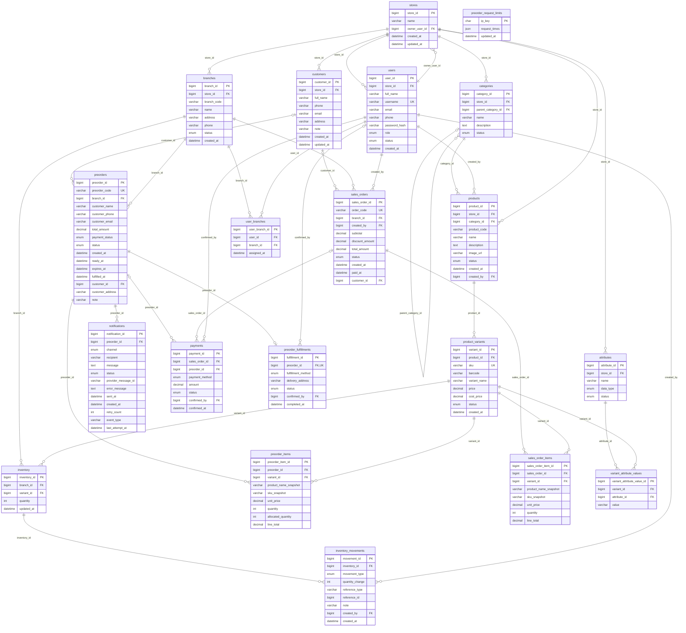

# Sơ đồ ERD - DKat

Sinh tự động từ CSDL đang chạy ngày 24/11/2026 (`information_schema`), khớp với `database/00_schema_full.sql`: 20 bảng, 34 khoá ngoại.
Bản ảnh / PDF: [erd.png](erd.png), [erd.pdf](erd.pdf). GitHub hiển thị trực tiếp sơ đồ Mermaid bên dưới.

Ký hiệu: `PK` khoá chính, `FK` khoá ngoại, `UK` duy nhất. `||--o{` một - nhiều; `|o--o{` khoá ngoại có thể NULL (vd. đơn của khách vãng lai không có `customer_id`).

| Nhóm | Bảng |
|---|---|
| Cửa hàng, chi nhánh, tài khoản | `stores`, `branches`, `users`, `user_branches` |
| Sản phẩm, tồn kho | `categories`, `products`, `product_variants`, `attributes`, `variant_attribute_values`, `inventory`, `inventory_movements` |
| Khách hàng, bán hàng | `customers`, `sales_orders`, `sales_order_items`, `payments` |
| Đặt trước, thông báo | `preorders`, `preorder_items`, `preorder_fulfillments`, `notifications`, `preorder_request_limits` |

